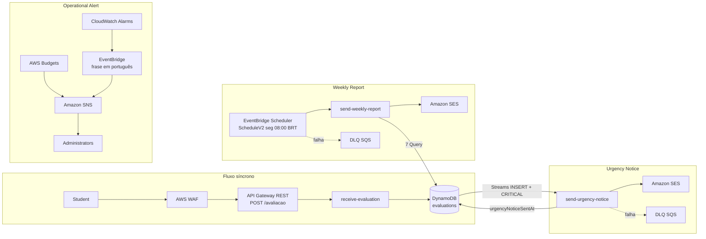

# feedback-platform

Tech Challenge da **Fase 4** da pós-graduação FIAP ADJT — Cloud Computing, Serverless e Deploy em nuvem.

Plataforma de feedback de aulas: estudantes avaliam as aulas, administradores recebem aviso imediato dos
itens críticos e um relatório semanal com a média das avaliações.

> **Estado:** desenho da aplicação e da cloud decidido (ADRs 0001–0027, todas `aceita`). As três funções, o template
> SAM, a bootstrap do OIDC e os workflows `ci` e `deploy` estão na `main`; o deploy automático roda em `sa-east-1`
> (ambiente único `demo`). A validação manual e a collection Postman estão em
> [`docs/validacao-manual.md`](docs/validacao-manual.md) e [`docs/postman/`](docs/postman/).
>
> **Prazo de entrega: 17/11/2026.**

Enunciado: [`docs/ADJT - Fase 4 - Tech Challenge_rev.pdf`](<docs/ADJT - Fase 4 - Tech Challenge_rev.pdf>).
Glossário: [`CONTEXT-MAP.md`](CONTEXT-MAP.md) — termos canônicos em inglês, mapeados para as palavras do enunciado.
Contrato HTTP: [`docs/contracts/receive-evaluation.md`](docs/contracts/receive-evaluation.md).

## O que o enunciado exige

| Bloco | Exigência |
|---|---|
| Regras | Serverless e cloud **obrigatórios**; mínimo de **2 funções**, com responsabilidade única — a separação é avaliada |
| Entrada | `POST /avaliação` com `{ "descricao": string, "nota": int 0–10 }` |
| Aviso de urgência (e-mail) | Descrição, urgência, data de envio |
| Relatório semanal | Média das avaliações; descrição, urgência, data de envio; quantidade por dia; quantidade por urgência |
| Ambiente | Segurança dos dados e governança de acesso; componentes de suporte (banco etc.); deploy automatizado dos componentes atualizáveis; monitoramento; notificação automática aos administradores para problemas críticos |
| Entrega | Repositório aberto + **vídeo** mostrando a aplicação, as funções serverless ativas e as configurações |
| Avaliação | Modelo de cloud e componentes explicados; funcionamento; código documentado; descrição com arquitetura, instruções de deploy, configuração do monitoramento e documentação das funções; configuração de nuvem e segurança explicadas |

## Arquitetura e modelo de cloud

Ambiente único **`demo`** em **`sa-east-1`** ([ADR 0021](docs/adr/0021-um-ambiente-so.md), [ADR 0011](docs/adr/0011-regiao-sao-paulo.md)). Stack CloudFormation/SAM: `feedback-platform`.



### Por que três funções e dois canais

- **Três funções, uma responsabilidade cada** ([ADR 0003](docs/adr/0003-tres-funcoes-aviso-nasce-da-gravacao.md)): a HTTP só grava; o aviso de urgência nasce do Streams após a gravação; o relatório semanal é outro gatilho (agendador). Falha ou escala de um fluxo não segura os outros.
- **SES para as funções de negócio** (Urgency Notice e Weekly Report): HTML + texto, remetente e destinatários da lista de Administrators ([ADR 0014](docs/adr/0014-ses-para-funcoes-sns-para-alerta.md), [ADR 0023](docs/adr/0023-remetente-e-o-primeiro-administrator.md)).
- **SNS para o Operational Alert**: caminho curto CloudWatch/Budgets → EventBridge (texto não técnico) → e-mail, separado do conteúdo pedagógico ([ADR 0007](docs/adr/0007-operational-alert-separado-do-urgency-notice.md)).

### Componentes de suporte

| Componente | Papel |
|---|---|
| DynamoDB `evaluations` | Partition key `submissionDay` (dia em `America/Sao_Paulo`); sort key `id`; Streams; TTL `expiresAt` (12 semanas) |
| API Gateway REST + WAF | Borda pública HTTPS; limites de corpo e taxa |
| EventBridge Scheduler | `ScheduleV2`, segunda 08:00 `America/Sao_Paulo` |
| SQS DLQs | Falhas do Streams (Urgency) e do agendador (Weekly) |
| CloudWatch | Logs das funções, alarmes, dashboard `feedback-platform-demo` |
| Pilha bootstrap OIDC | Fora do `template.yaml`: role `feedback-platform-deploy` ([`infra/bootstrap-oidc.yaml`](infra/bootstrap-oidc.yaml)) |

Outputs úteis da stack (console CloudFormation, sem colar ARNs com ID de conta neste README): `ApiEndpoint`, `EvaluationsTableName`, `OperationalAlertTopicArn`.

## Funções e módulos do monorepo

Monorepo Maven, **Java 25**, **SnapStart** ligado nas três Lambdas ([ADR 0004](docs/adr/0004-framework-escolhido-pelo-gatilho.md), [ADR 0011](docs/adr/0011-regiao-sao-paulo.md)). Nomes publicados: `feedback-platform-receive-evaluation`, `feedback-platform-send-urgency-notice`, `feedback-platform-send-weekly-report`.

### `domain`

Biblioteca Java pura (sem framework de nuvem): `Score`, `Urgency`, `Evaluation`, `ReportWeek`, `WeeklyReport`. Regras de faixa CRITICAL/MEDIUM/LOW e agregação da semana.

### `email-support`

Montagem HTML/texto, escape de Description e rótulos em português dos e-mails de Urgency Notice e Weekly Report.

### `receive-evaluation` (Quarkus)

| | |
|---|---|
| **Responsabilidade** | Validar o contrato e gravar a Evaluation |
| **Gatilho** | `POST /avaliacao` via API Gateway |
| **Entrada** | JSON `{ "descricao", "nota" }` (`application/json`) |
| **Saída** | `201` com `id` e `dataEnvio` (sem `urgency`, sem `Location`); ou `problem+json` |
| **Env** | `EVALUATIONS_TABLE` |
| **Permissões** | Role `feedback-platform-receive-evaluation`: `dynamodb:PutItem` na tabela + logs próprios |

### `send-urgency-notice` (Spring Boot)

| | |
|---|---|
| **Responsabilidade** | Enviar Urgency Notice só para `CRITICAL` e marcar `urgencyNoticeSentAt` |
| **Gatilho** | DynamoDB Streams, filtro `INSERT` + `urgency = CRITICAL` |
| **Entrada** | Registros do Streams (lote com `ReportBatchItemFailures`) |
| **Saída** | E-mail SES; atualização da marca na Evaluation; falhas → DLQ após tentativas |
| **Env** | `EVALUATIONS_TABLE`, `ADMINISTRATORS` (lista CSV; 1º = remetente SES) |
| **Permissões** | Role `feedback-platform-send-urgency-notice`: leitura/atualização restrita à marca, `ses:SendEmail` com `FromAddress`, DLQ, logs |

### `send-weekly-report` (Spring Boot)

| | |
|---|---|
| **Responsabilidade** | Consolidar a Report Week (seg–dom Brasília) e enviar o relatório |
| **Gatilho** | EventBridge Scheduler (`cron(0 8 ? * MON *)`, fuso `America/Sao_Paulo`) ou invoke manual |
| **Entrada** | Evento com `time` (agendado) ou mapa/string com `reportWeek` / `week` (ex.: `2026-W46`) |
| **Saída** | E-mail SES (média, contagens por dia e por urgência; teto de 500 na lista) |
| **Env** | `EVALUATIONS_TABLE`, `ADMINISTRATORS`, região AWS |
| **Permissões** | Role `feedback-platform-send-weekly-report`: `dynamodb:Query`, SES, logs. Role à parte `feedback-platform-scheduler` só invoca a função e a DLQ do agendador |

## Segurança dos dados e governança de acesso

### Borda (API Gateway REST + WAF)

([ADR 0006](docs/adr/0006-endpoint-anonimo.md), [ADR 0015](docs/adr/0015-rest-api-com-waf.md))

- Corpo até **8 KB** → `413`
- **300** requisições / 5 min por IP → `429`
- Teto global **20 req/s** (burst 50) → `429`
- HTTPS obrigatório; logs de acesso do API Gateway com retenção curta (14 dias)

### Privacidade e retenção

([ADR 0009](docs/adr/0009-dados-gravados-retencao-e-logs.md))

- Payload sem identidade do Student
- TTL de **12 semanas** (`expiresAt`)
- CloudWatch Logs **sem** Description, **sem** valor recusado em validação, **sem** e-mail de Administrator

### Criptografia

([ADR 0018](docs/adr/0018-criptografia-padrao-da-aws.md))

- Trânsito: TLS
- Repouso: chaves padrão da AWS (DynamoDB, Streams, SQS SSE-SQS, Logs, artefatos S3 SSE-S3)
- Tópico SNS do Operational Alert sem SSE de servidor (justificativa na ADR): o caminho prioriza entrega do alerta operacional

### Roles IAM (privilégio mínimo)

([ADR 0019](docs/adr/0019-uma-role-por-funcao.md))

1. `feedback-platform-receive-evaluation`
2. `feedback-platform-send-urgency-notice`
3. `feedback-platform-send-weekly-report`
4. `feedback-platform-scheduler`

Condições restritivas onde cabem (`dynamodb:Attributes` na marca do Urgency Notice; `ses:FromAddress`). Permissions boundary criada na bootstrap impede roles `feedback-platform-*` largas.

### Conta e pipeline

([ADR 0012](docs/adr/0012-iac-com-aws-sam.md), [ADR 0013](docs/adr/0013-pipeline-deploy-automatico-oidc.md))

- Deploy via **OIDC** (sem chave de longa duração no GitHub): role `feedback-platform-deploy`, confiança só na branch `main`, região `sa-east-1` e recursos `feedback-platform-*`
- Acesso humano: grupo de administradores com **MFA**, console / `aws login`; emergência separada — **não** versionar ID de conta AWS, ARNs reais com account id, nem e-mails de integrantes neste repositório público

## Build, testes e deploy

### Local

Pré-requisitos típicos: JDK 25, Maven 3.9+, Docker (Testcontainers / DynamoDB Local), SAM CLI (com `SAM_CLI_ENABLE_LANGUAGE_EXTENSIONS=1` se o CLI exigir — o template usa `AWS::LanguageExtensions`).

```bash
mvn clean verify
sam validate --lint --template template.yaml
```

Validação ponta a ponta na demo (roteiro + collection):

- [`docs/validacao-manual.md`](docs/validacao-manual.md)
- [`docs/postman/`](docs/postman/) — variável `baseUrl` = output `ApiEndpoint` da stack
- Evidências de uma execução: [`docs/evidencias-t10/`](docs/evidencias-t10/)

### Estratégia de testes automatizados

1. **`domain`** — unitários: Scores × faixas; agregação do Weekly Report (semana vazia, fronteira de domingo em Brasília, teto de 500).
2. **`receive-evaluation`** — tabela do contrato → `201` / `problem+json`; DynamoDB emulado.
3. **`send-urgency-notice` / `send-weekly-report`** — só CRITICAL gera aviso; idempotência da marca; escape HTML; mesma semana → mesmo relatório.
4. Regras críticas: teste que quebra o código de propósito precisa ficar vermelho.
5. **Ponta a ponta** — roteiro e Postman acima (também base do vídeo).

### Bootstrap OIDC (uma vez por conta)

Aplicar [`infra/bootstrap-oidc.yaml`](infra/bootstrap-oidc.yaml) em `sa-east-1` com um administrador MFA (fora do deploy contínuo). Cria o provedor OIDC do GitHub Actions (se ainda não existir), a role `feedback-platform-deploy`, o permissions boundary das funções e, se pedido, a role de logs do API Gateway.

### Variables do GitHub (repositório)

Documentar só com placeholders — **não** colocar e-mails reais nem o ARN completo com account id no README:

| Variable | Uso |
|---|---|
| `ADMINISTRATORS` | Lista CSV dos Administrators; **primeiro** endereço = remetente SES e identidade a verificar |
| `AWS_DEPLOY_ROLE_ARN` | ARN da role `feedback-platform-deploy` (preencher no GitHub, não neste arquivo) |

### Deploy automático e redeploy

- **CI** (`.github/workflows/ci.yml`): em toda PR e no push da `main`.
- **Deploy** (`.github/workflows/deploy.yml`): após `ci` verde no push da `main` (OIDC); exige as variables acima; termina com **teste de fumaça** que grava uma Evaluation, confere SnapStart e **apaga** a Evaluation para não poluir o Weekly Report ([ADR 0024](docs/adr/0024-teste-de-fumaca-apaga-a-propria-evaluation.md), [ADR 0025](docs/adr/0025-teste-de-fumaca-remove-por-descricao.md)).
- **Redeploy manual**: `workflow_dispatch` com `ref` = SHA que já foi estado da `main` (linha de primeiros pais) ([ADR 0026](docs/adr/0026-redeploy-manual-de-commit-da-main.md), [ADR 0027](docs/adr/0027-redeploy-so-da-linha-principal-da-main.md)).

### Pós-deploy (Administrators)

1. Confirmar e-mails de **verificação SES** (sandbox) e de **assinatura SNS** do tópico Operational Alert.
2. Cada Administrator cria na própria caixa a regra **“nunca enviar para o spam”** para o remetente (= 1º de `ADMINISTRATORS`), porque o e-mail chega sem autenticação forte de domínio ([ADR 0023](docs/adr/0023-remetente-e-o-primeiro-administrator.md)).
3. Uma vez: acrescentar o ARN do tópico Operational Alert (output da stack) às notificações de **80%** e **100%** do orçamento da conta (gatilho 5 — Budgets opera fora de `sa-east-1` no console).

## Monitoramento e procedimentos operacionais

### Operational Alert

Caminho: alarme CloudWatch → regra EventBridge com `InputTransformer` (frase em português) → tópico SNS `feedback-platform-operational-alert` → Administrators. Os alarmes **não** usam `AlarmActions` diretas ([ADR 0014](docs/adr/0014-ses-para-funcoes-sns-para-alerta.md), [ADR 0016](docs/adr/0016-alarmes-do-operational-alert.md)).

| # | Gatilho | Dispara quando | Frase (resumo) |
|---|---|---|---|
| 1 | Critical sem Urgency Notice | ≥ 1 msg na DLQ da `send-urgency-notice` | avaliação crítica não pôde ser avisada |
| 2a | Falha ao receber | ≥ 5 `5XXError` do API Gateway / 5 min | estudantes não conseguem enviar |
| 2b | Falha no Urgency Notice | ≥ 3 `Errors` da função / 5 min | envio de avisos falhando |
| 3 | Weekly falhou / não rodou | ≥ 1 erro da função **ou** msg na DLQ do agendador | relatório semanal não enviado |
| 4a | Volume anormal | > 150 req API / 5 min | volume acima do normal |
| 4b | WAF barrando | ≥ 50 bloqueios / 5 min | envio automatizado bloqueado |
| 4c | Enxurrada CRITICAL | > 30 invocações da `send-urgency-notice` / 15 min | número anormal de críticas |
| 5 | Custo | orçamento 80% / 100% | texto padrão do AWS Budgets |

Dashboard: **`feedback-platform-demo`** (requisições, Critical Evaluations, erros, DLQs, bloqueios WAF).

### Reenvio de Urgency Notice

A recuperação **não** depende da DLQ do Streams (ponteiro expira rápido). Usa a marca na tabela ([ADR 0017](docs/adr/0017-tentativas-e-filas-de-falha.md), [ADR 0005](docs/adr/0005-entrega-pelo-menos-uma-vez.md)):

1. No DynamoDB (`sa-east-1`), partição `submissionDay` = dia desejado (`yyyy-MM-dd` em Brasília).
2. Localizar itens com `urgency = CRITICAL` **sem** atributo `urgencyNoticeSentAt`.
3. Reenviar o aviso (fluxo operacional / reprocessamento alinhado à função) até a marca aparecer — sem inventar função nova no template.

### Invoke manual do Weekly Report

Se o agendado esgotar as ~4 h de tentativas ([ADR 0017](docs/adr/0017-tentativas-e-filas-de-falha.md)):

1. Console Lambda → `feedback-platform-send-weekly-report` → Test / Invoke.
2. Payload com a semana desejada, por exemplo:

```json
{ "reportWeek": "2026-W46" }
```

(Também aceita string `"2026-W46"` ou o envelope agendado com `time` ISO-8601.)

## Como decidimos

Toda decisão de desenho vira ADR em `docs/adr/`, com status **`proposta`**. Ela é avisada no canal do grupo com o link;
**sem objeção em 48 horas, passa a `aceita`**. Uma objeção dentro do prazo mantém a ADR em `proposta` até ser
discutida. Uma ADR aceita só é contrariada por outra ADR que a substitua.

## Decisões tomadas

| ADR | Decisão | Status |
|---|---|---|
| [0001](docs/adr/0001-urgencia-derivada-da-nota.md) | Urgency derivada do Score: 0–3 `CRITICAL`, 4–6 `MEDIUM`, 7–10 `LOW`; só `CRITICAL` gera o Urgency Notice | aceita |
| [0002](docs/adr/0002-codigo-em-ingles-contrato-em-portugues.md) | Código e termos canônicos em inglês; contrato HTTP e e-mails em português | aceita |
| [0003](docs/adr/0003-tres-funcoes-aviso-nasce-da-gravacao.md) | Três funções, uma aplicação por função; o aviso nasce da gravação da Evaluation | aceita |
| [0004](docs/adr/0004-framework-escolhido-pelo-gatilho.md) | Java 25; Quarkus na função HTTP, Spring Boot nas que enviam e-mail; monorepo Maven | aceita |
| [0005](docs/adr/0005-entrega-pelo-menos-uma-vez.md) | Urgency Notice "pelo menos uma vez", com marca na Evaluation; duplicatas aceitas | aceita |
| [0006](docs/adr/0006-endpoint-anonimo.md) | `POST /avaliacao` anônimo, com limites na borda | aceita |
| [0007](docs/adr/0007-operational-alert-separado-do-urgency-notice.md) | Operational Alert para falhas da plataforma, separado do Urgency Notice | aceita |
| [0008](docs/adr/0008-regras-do-weekly-report.md) | Report Week de segunda a domingo em Brasília; teto de 500 na lista; semana vazia também envia | aceita |
| [0009](docs/adr/0009-dados-gravados-retencao-e-logs.md) | Nada que identifique o Student; retenção de 12 semanas; Description fora do log | aceita |
| [0010](docs/adr/0010-dynamodb-particionado-por-dia.md) | DynamoDB particionado pelo dia da submissão em Brasília; TTL de 12 semanas; o Urgency Notice sai do Streams, filtrado na assinatura | aceita |
| [0011](docs/adr/0011-regiao-sao-paulo.md) | Tudo em `sa-east-1` (São Paulo); o SnapStart é provado no primeiro deploy | aceita |
| [0012](docs/adr/0012-iac-com-aws-sam.md) | Infraestrutura como código com AWS SAM; usuários IAM e a pilha de OIDC do pipeline ficam fora do template | aceita |
| [0013](docs/adr/0013-pipeline-deploy-automatico-oidc.md) | Deploy automático a cada merge na `main`, por OIDC, com role restrita a `sa-east-1` e a roles `feedback-platform-*` | aceita |
| [0014](docs/adr/0014-ses-para-funcoes-sns-para-alerta.md) | SES para o Urgency Notice e o Weekly Report; Operational Alert por CloudWatch → EventBridge → SNS, em texto não técnico | aceita |
| [0015](docs/adr/0015-rest-api-com-waf.md) | API Gateway REST com WAF: corpo até 8 KB, 300 requisições em 5 min por IP, teto de 20/s | aceita |
| [0016](docs/adr/0016-alarmes-do-operational-alert.md) | Métricas e limites dos alarmes do Operational Alert (DLQ ≥ 1, volume > 150 em 5 min, entre outros) e dashboard | aceita |
| [0017](docs/adr/0017-tentativas-e-filas-de-falha.md) | Urgency Notice: 3 tentativas, até 1 hora, depois DLQ; reenvio pela marca na tabela. Weekly Report: até 4 horas | aceita |
| [0018](docs/adr/0018-criptografia-padrao-da-aws.md) | Criptografia em repouso com as chaves padrão da AWS; TLS em trânsito; acesso ao dado controlado pelas roles | aceita |
| [0019](docs/adr/0019-uma-role-por-funcao.md) | Uma role por função com privilégio mínimo; a função pública só grava | aceita |
| [0020](docs/adr/0020-lista-de-administrators-no-github.md) | Lista de Administrators numa variável do GitHub, que gera os destinatários do SES, as assinaturas do SNS e as verificações | aceita |
| [0021](docs/adr/0021-um-ambiente-so.md) | Um ambiente só na AWS, `demo`; o `ci` e o teste de fumaça seguram o defeito antes dela | aceita |
| [0022](docs/adr/0022-send-urgency-notice-le-a-marca.md) | A `send-urgency-notice` lê só a marca do Urgency Notice antes de enviar; no Streams, lote com falha reentrega também os itens seguintes | aceita |
| [0023](docs/adr/0023-remetente-e-o-primeiro-administrator.md) | O remetente do SES é o primeiro endereço da lista de Administrators; o e-mail chega sem autenticação, e cada Administrator o tira do spam por regra | aceita |
| [0024](docs/adr/0024-teste-de-fumaca-apaga-a-propria-evaluation.md) | O teste de fumaça do deploy apaga a própria Evaluation, para ela não entrar no Weekly Report; falha se não conseguir | aceita |
| [0025](docs/adr/0025-teste-de-fumaca-remove-por-descricao.md) | O teste de fumaça remove por Description nas partições da execução, limpando também órfãs de retentativas | aceita |
| [0026](docs/adr/0026-redeploy-manual-de-commit-da-main.md) | O `deploy` aceita redeploy manual de um commit da `main`, para rollback; o `ci` roda em toda PR e só no push da `main` | aceita |
| [0027](docs/adr/0027-redeploy-so-da-linha-principal-da-main.md) | O redeploy manual só aceita commit que já foi o estado da `main` (linha de primeiros pais), não qualquer ancestral | aceita |

### Desvios do enunciado, e por quê

- **A rota é `/avaliacao`, sem acento.** Em HTTP o path só admite ASCII: `ç` e `ã` trafegam codificados, e cada
  cliente HTTP e gateway trata isso de um jeito. Detalhe no [contrato](docs/contracts/receive-evaluation.md#rota).
- **O exemplo de JSON do enunciado tem uma vírgula sobrando**: é ilustração, não contrato.

## Limitações declaradas

- **Urgency Notice duplicado é possível**, raramente: o envio de e-mail não entra em transação com o banco
  ([ADR 0005](docs/adr/0005-entrega-pelo-menos-uma-vez.md)).
- **Evaluation duplicada por reenvio do cliente é aceita**: o payload não tem identificador para distinguir um
  reenvio de duas Evaluations iguais.
- **O endpoint é anônimo**: uma enxurrada de Evaluations com Score baixo gera uma enxurrada de Urgency Notices. O
  limite de taxa freia; o login de Student seria a solução ([ADR 0006](docs/adr/0006-endpoint-anonimo.md)).
- **Um Weekly Report de mais de 12 semanas atrás não pode ser gerado de novo**
  ([ADR 0009](docs/adr/0009-dados-gravados-retencao-e-logs.md)).
